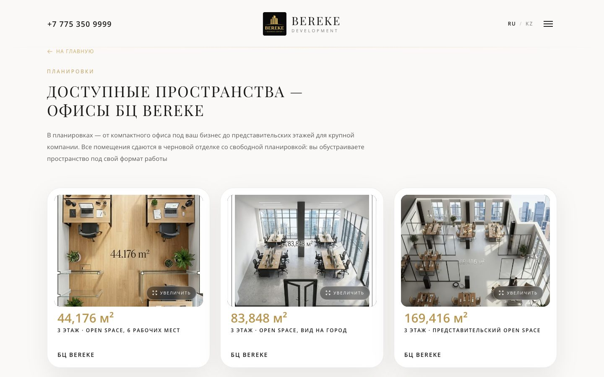
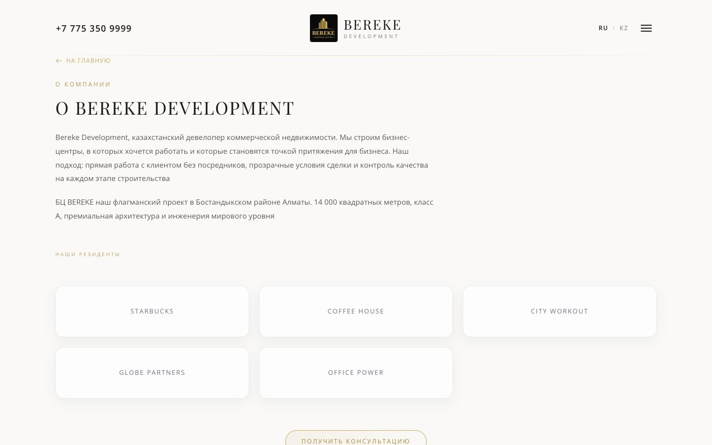
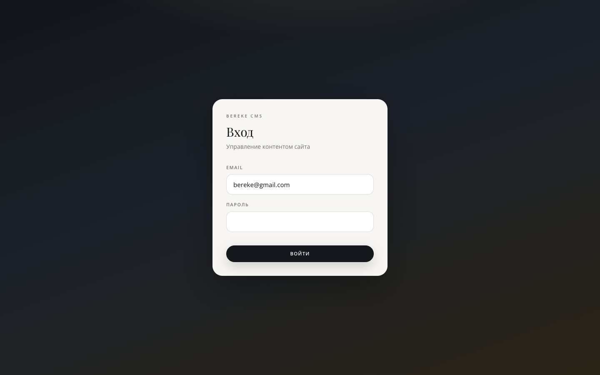

<div align="center">

# Bereke Development

**A class-A business center in Almaty, shipped as a section-editable Next.js 16 site.**
Video first screen, an office-matching calculator whose lots and prices live in the
database, `ru`/`kk` everywhere, and an admin panel the client's own staff operates.

**Live:** [bc-bereke.kz](https://bc-bereke.kz) · **Demo build:** [bereke-development.vercel.app](https://bereke-development.vercel.app)


</div>

---

<table>
  <tr>
    <td width="50%"></td>
    <td width="50%"></td>
  </tr>
  <tr>
    <td></td>
    <td></td>
  </tr>
  <tr>
    <td colspan="2" align="center"></td>
  </tr>
</table>

## The problem

A developer's website has one job: get a qualified leasing enquiry. Most of them
fail at the handoff to the client's own team — the copy is frozen in JSX, the
price list is a PDF, and changing a phone number requires a deploy.

Bereke is built the other way round. Every text block, every office lot, every
price and both languages live in Postgres and are edited in `/admin` by section.
The code ships the layout, the motion and the calculator; the client owns the
content.

## What this is (and what it isn't)

**It is a content-driven marketing site, not a CMS framework.** Two tables —
`site_content` and `media_assets` — hold a typed document (`lib/content-types.ts`,
379 lines of interfaces) that the whole site renders from.

**It is not a lead-capture app.** There is no enquiry form and no CRM webhook.
The floating consultation button, the footer and every CTA open a messenger or
dial the number in `lib/site-data.ts` (phone, WhatsApp, Instagram, PDF brochure,
two addresses) — because for a class-A office lease, the conversation starts in
WhatsApp, and a form that nobody answers is worse than none.

**It is bilingual by construction.** `ru` / `kk` are a single `Locale` union;
UI chrome comes from `lib/i18n/translations.ts`, and every CMS text field carries
a `copyKk` sibling, so an editor fills both columns in the same form.

## The map

```
  browser ─────────────────────────────────────────────────────────────┐
  │  /            hero video · layouts · gallery · contacts           │
  │  /spaces      office picker + PriceCalculator (529 lines)         │
  │  /developer   about the developer                                 │
  │  /privacy-policy · /terms-of-use                                  │
  │                                                                   │
  │  /admin/login → /admin → /admin/sections/[section] · /admin/media │
  │                 /admin/settings · /admin/calculator               │
  └───────────────┬───────────────────────────────────────────────────┘
                  │ 6 route handlers under app/api/admin/**
        middleware.ts (56 lines) ── verifies the session JWT in the Edge
                  │                 runtime with the same `jose` key
        ┌─────────┴──────────┐
        │  PostgreSQL        │  site_content · media_assets
        └─────────┬──────────┘
                  │  lib/content.ts + default-content.ts (440 lines of fallbacks)
        typed document → React Server Components
                  │
        lib/optimize-upload.ts ── sharp: images → WebP ≤2560px long edge
                                   videos → H.264/AAC mp4 via ffmpeg if present
```

## What makes it different

- **The admin panel is the product surface.** Six endpoints (`login`, `logout`,
  `me`, `content`, `media`, `upload`) cover the whole editing loop; the section
  editor is data-driven, so adding a new editable block means extending the type,
  not writing a new form.
- **Auth is verified in the Edge middleware with the same key as the Node
  runtime.** `lib/auth-edge.ts` exists because `jose` is the only JWT library that
  runs on both sides — no shared-secret bridge, no second session store, and an
  unauthenticated hit on `/admin/*` or `/api/admin/*` never reaches a page.
- **The header reads the page under it.** `lib/detect-header-surface.ts` samples
  `document.elementsFromPoint()` at the header's own coordinates and switches its
  chrome when a light section (`[data-header-surface="light"]`,
  `.section-bg-limestone`) passes behind it. One line of CSS cannot do this.
- **The office calculator is content, not code.** Lots, area bounds and price per
  m² are `calculatorLots` / `calculator` rows edited at `/admin/calculator`, so
  the sales team reprices the building without a release.
- **Uploads are optimized at write time, not at request time.** Admin uploads go
  through sharp to WebP with a 2560px ceiling; video is transcoded to H.264/AAC
  when `ffmpeg` is on the server, and stored as-is when it is not.
- **The demo and production are the same bytes.** Both were measured side by side:
  HTTP 200, 7,586 visible characters of text, 25 images, zero broken assets,
  exactly one `<h1>`, hero video playing. That is the check that lets the Vercel
  URL be used as a review build for a site that runs on the client's own server.

## Feature map

| Area | Where | What it does |
|---|---|---|
| Typed content document | `lib/content-types.ts`, `lib/content.ts` | one interface tree for the whole site, 440 lines of defaults as fallback |
| Section editor | `app/admin/sections/[section]/page.tsx` | per-section text and media editing, both languages in one form |
| Media library | `app/admin/media`, `lib/media.ts` | browse, upload, replace; rows in `media_assets` |
| Office picker | `app/components/PriceCalculator.tsx` | area + purpose + floor → price, over CMS-driven lots |
| Layouts gallery | `app/components/LayoutsSection.tsx` | floor plans tied to the same lot data |
| i18n | `lib/i18n/{locale,localized,translations,locale-context}` | `ru`/`kk`, persisted in `localStorage['bereke-locale']` |
| Upload pipeline | `lib/optimize-upload.ts` | sharp WebP + optional ffmpeg transcode, MIME allow-list |
| Header surface | `lib/detect-header-surface.ts` | light/dark chrome switch by sampled DOM |
| SEO | `lib/seo.ts` | metadata and OG per route |
| Sessions | `lib/auth.ts`, `lib/auth-edge.ts`, `middleware.ts` | env-based single admin, `timingSafeEqual` compare, JWT cookie verified at the edge |
| Analytics | `app/components/GoogleTagManager.tsx`, `YandexMetrika.tsx` | GTM container and Yandex.Metrika counter, both id-driven |

## Stack and size

| 14 507 | 98 | 12 | 6 | 2 | 2 285 | 6 |
| --- | --- | --- | --- | --- | --- | --- |
| lines of TS/TSX | source files | pages | API routes | Postgres tables | lines of CSS | runtime deps |

Next.js 16 App Router, TypeScript, Tailwind CSS. Runtime dependencies are exactly
`next`, `react`, `react-dom`, `pg`, `jose`, `sharp` — no UI kit, no animation
library, no CMS SDK, no auth provider. Motion is hand-written CSS/`requestAnimationFrame`
(`lib/scroll-y.ts`, `lib/use-scroll-lock.ts`).

## Run it

```bash
git clone https://github.com/NikitaKoreshkov/bereke-development && cd bereke-development
npm install
cp .env.example .env      # DATABASE_URL, ADMIN_PASSWORD, AUTH_SECRET
npm run db:setup          # creates site_content + media_assets
npm run db:seed           # loads the default content document
npm run dev               # http://localhost:3000
```

Without `DATABASE_URL` the public pages still render: `lib/content.ts` falls back
to `default-content.ts`, so the site is reviewable with no database at all. The
admin panel is what needs Postgres.

## Known limits

- **One admin account, from the environment.** `ADMIN_EMAIL` / `ADMIN_PASSWORD`
  are compared with `crypto.timingSafeEqual` and there is no `admin_users` table —
  no user management, no password reset, no audit trail of who edited what.
- **No enquiry form, therefore no spam surface** — and no lead record. If the
  client ever wants statistics on enquiries, they come from messenger or call
  tracking, not from this database.
- **Two prototype files sit at the repo root** (`bereke-calculator.jsx`,
  `calculator.jsx`, 963 lines total). They are the original handoff prototypes and
  are imported by nothing; the live calculator is `app/components/PriceCalculator.tsx`.
- **No automated tests.** Correctness is checked by the production/demo parity
  measurement described above and by hand.
- **Analytics is wired but hardcoded.** Google Tag Manager (`GTM-*`), a GA4
  property inside that container and a Yandex.Metrika counter live as literals in
  `app/components/GoogleTagManager.tsx` and `YandexMetrika.tsx`, so moving the
  site to another property means a code change, not an env change. Search Console
  and Webmaster verification codes are the only env-driven SEO bits.

## Коротко по-русски

Одностраничник бизнес-центра класса А в Алматы плюс разделы застройки и продажи и
полноценная админка. Контент — типизированный документ в PostgreSQL: две таблицы
(`site_content`, `media_assets`), 440 строк дефолтов как страховка, и редактор по
секциям, где один текст правится сразу в двух языках (`ru` / `kk`, ключ
`bereke-locale`). Авторизация админки — JWT на `jose`, который проверяется тем же
ключом и в Edge-промежуточном слое (`lib/auth-edge.ts`), поэтому запрос без сессии
не долетает до страницы. Калькулятор подбора помещений (529 строк) работает поверх
лотов из базы, то есть отдел продаж меняет цены и планировки без релиза. Загрузки
прогоняются через sharp в WebP с потолком 2560 px по длинной стороне, видео — через
ffmpeg, если он есть на сервере. Шапка сайта сама определяет, какая секция под ней
проходит, через `elementsFromPoint` (lib/detect-header-surface.ts), и меняет хром.
Форм на сайте нет и не было: все CTA ведут в WhatsApp, звонок и PDF-брошюру из
`lib/site-data.ts`, поэтому интеграции с CRM в коде тоже нет — в описании репозитория
это было указано зря. Прод и демо-сборка сверялись измерением: HTTP 200, 7 586
видимых знаков, 25 изображений, ноль битых, один `<h1>`, hero-видео играет. Тестов
нет, учётная запись администратора одна, в корне лежат два не используемых
JSX-прототипа калькулятора.

## Rights

© 2026 Nikita Koreshkov. Portfolio piece, all rights reserved. The BEREKE name,
logo, photography, floor plans, prices and contacts belong to the developer.
